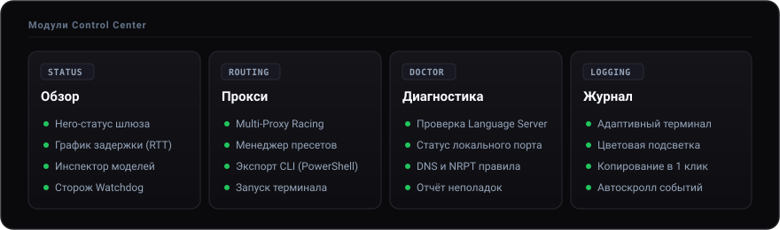

<div align="center">


# Open Antigravity

**Портативная среда для комфортной работы с Google Antigravity в любом регионе**

[](https://github.com/keelbismark/OpenAntigravity/releases)
[](LICENSE)
[](#)
[](https://keelbismark.github.io/OpenAntigravity/)

[Сайт проекта](https://keelbismark.github.io/OpenAntigravity/) • [Скачать Antigravity](https://antigravity.google/download) • [Быстрый старт](#быстрый-запуск) • [Свой прокси (VPS)](PROXY_SETUP.md)

</div>

> **Open Antigravity** — автономный центр управления для работы с Google Antigravity (Antigravity 2.0, IDE, CLI). Обеспечивает стабильный доступ к AI-моделям из любого региона под личным Google-аккаунтом без необходимости включать VPN для всей операционной системы.
>
> Редактор загружается отдельно: **[Скачать Google Antigravity с официального сайта](https://antigravity.google/download)**.

---

## Архитектура и принцип работы

Open Antigravity использует избирательную маршрутизацию: через локальный шлюз проходят исключительно служебные запросы к API AI-моделей Google. Весь остальной трафик системы продолжает работать напрямую на полной скорости вашего интернет-провайдера.

<p align="center">
  
</p>

---

## Модули Control Center

Графический интерфейс разделен на четыре специализированных экрана для прозрачного контроля соединения и окружения:

<p align="center">
  
</p>

### Обзор
* **Статус подключения** — интерактивная индикация состояния шлюза в реальном времени.
* **Live RTT Мониторинг** — непрерывный замер задержки отклика до серверов Google AI с графиком колебаний пинга.
* **Инспектор активности моделей** — отслеживание обращений Language Server к моделям в реальном времени.
* **Установки IDE** — автоматическое обнаружение инсталляций Antigravity и управление фоновым сторожем (Watchdog).

### Прокси
* **Поддержка собственных узлов** — работа с любыми HTTP/CONNECT прокси (`логин:пароль@хост:порт`).
* **Multi-Proxy Racing** — автоматическое соревнование нескольких серверов по задержке с выбором самого отзывчивого.
* **Менеджер пресетов** — быстрое переключение между сохраненными серверами в один клик.
* **Окружение терминала (CLI)** — экспорт переменных `HTTP_PROXY` / `HTTPS_PROXY` для PowerShell, CMD и Bash, а также запуск преднастроенного окна консоли.

### Диагностика
* **Комплексный Doctor** — сквозная проверка компонентов IDE, целостности патча, сетевых портов и внешнего шлюза.
* **Автоисправление** — устранение конфликтов портов и прав доступа в один клик.
* **Экспорт отчета** — формирование подробного диагностического среза для решения технических проблем.

### Журнал
* **Адаптивный терминал событий** — полноэкранный лог с автопрокруткой и подсветкой типов записей.
* **Быстрое копирование** — копирование содержимого журнала в буфер обмена с мгновенным визуальным подтверждением.

---

## Быстрый запуск

### Графический интерфейс (GUI)

Готовые сборки актуальной версии доступны на странице **[GitHub Releases](https://github.com/keelbismark/OpenAntigravity/releases/latest)**:

| Платформа | Сборка | Запуск |
|---|---|---|
| **Windows 10 / 11** | [OpenAntigravity-windows-portable.zip](https://github.com/keelbismark/OpenAntigravity/releases/latest/download/OpenAntigravity-windows-portable.zip) | Распаковать архив и запустить `OpenAntigravity.exe` |
| **Linux (Steam Deck / Ubuntu / Fedora)** | [OpenAntigravity-x86_64.AppImage](https://github.com/keelbismark/OpenAntigravity/releases/latest/download/OpenAntigravity-x86_64.AppImage) | `chmod +x OpenAntigravity-x86_64.AppImage && ./OpenAntigravity-x86_64.AppImage` |
| **Linux Portable** | [OpenAntigravity-linux-portable.tar.gz](https://github.com/keelbismark/OpenAntigravity/releases/latest/download/OpenAntigravity-linux-portable.tar.gz) | Распаковать архив и запустить `./launch.sh` |

### Терминальный режим (TUI) в одну строку

* **Linux / Steam Deck:**
  ```bash
  curl -fsSL https://raw.githubusercontent.com/keelbismark/OpenAntigravity/main/tui.sh | sh
  ```

* **Windows (PowerShell):**
  ```powershell
  irm https://raw.githubusercontent.com/keelbismark/OpenAntigravity/main/tui.ps1 | iex
  ```

---

## Руководство по использованию

1. Установите Google Antigravity с официального сайта: [antigravity.google/download](https://antigravity.google/download).
2. Запустите Open Antigravity (на Windows рекомендуется запуск от имени администратора для настройки DNS-правил).
3. Нажмите кнопку **«Подключить Antigravity»** на вкладке «Обзор».
4. Откройте Antigravity, авторизуйтесь под личным Google-аккаунтом и начните работу — статус покажет: *«Подключено»*.

### Настройка собственного прокси
* На вкладке **«Прокси»** введите адрес сервера (`логин:пароль@хост:порт`) и нажмите **«Сохранить как профиль»**.
* Для настройки автоматического подбора лучшего узла укажите несколько серверов через точку с запятой:
  ```text
  user:pass@ip1:port;user:pass@ip2:port
  ```
  Open Antigravity замерит пинг каждого узла и переключится на самый быстрый.
* Руководство по поднятию собственного прокси (Tinyproxy) на VPS: [**`PROXY_SETUP.md`**](PROXY_SETUP.md).

### Работа с консолью и терминалом (CLI)
* Чтобы утилиты `git`, `curl`, `python`, `npm` работали через шлюз, нажмите кнопку нужной оболочки (**«PowerShell»**, **«CMD»** или **«Bash / Zsh»**) на вкладке «Прокси» — команда экспорта переменных скопируется в буфер обмена.
* Либо нажмите кнопку **«Запустить терминал»** для открытия окна консоли с преднастроенными переменными.

---

## Консольные параметры

Бинарный файл поддерживает флаги командной строки:

* `--check`, `--diagnose` — выполнение полной сетевой и системной самодиагностики в терминале.
* `--tui`, `--cli` — принудительный запуск в текстовом интерфейсе (TUI).
* `--shortcut` — создание ярлыков на Рабочем столе и в главном меню приложений.
* `--minimized`, `-m`, `--tray` — запуск программы свёрнутой в системный трей.
* `--about`, `--version` — информация о сборке и лицензии.

---

## Сборка из исходников

Для сборки требуется компилятор Rust (**MSRV ≥ 1.95**, в связи с API eframe 0.36.1):

```bash
git clone https://github.com/keelbismark/OpenAntigravity.git
cd OpenAntigravity
cargo build --release
```

Готовый бинарный файл будет находиться в каталоге `target/release/`.

### Сборочные скрипты

* **Windows:**
  ```bat
  build.cmd            # Сборка портативной папки dist_portable\
  build.cmd --package  # Упаковка в релизный zip-архив
  build.cmd --check    # Проверка исходников и запуск тестов
  ```

* **Linux:**
  ```bash
  bash build.sh            # Сборка glibc-версии
  bash build.sh --musl     # Сборка статической версии (TUI)
  bash build.sh --package  # Упаковка портативного дистрибутива
  bash build_appimage.sh   # Сборка Linux AppImage
  ```

---

## Лицензия

Проект распространяется под свободной лицензией [MIT](LICENSE).  
Open Antigravity не аффилирован с Google LLC. Все товарные знаки принадлежат их законным владельцам.
