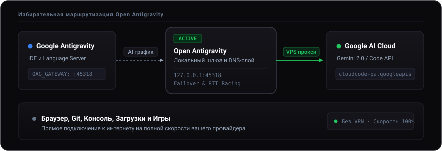

<div align="center">


# Open Antigravity

**Портативная среда для работы с Google Antigravity в любом регионе**

[](https://github.com/keelbismark/OpenAntigravity/releases)
[](LICENSE)
[](#)
[](https://keelbismark.github.io/OpenAntigravity/)

[Сайт проекта](https://keelbismark.github.io/OpenAntigravity/) • [Скачать Antigravity](https://antigravity.google/download) • [Загрузка](#загрузка) • [Свой прокси (VPS)](PROXY_SETUP.md)

</div>

> **Open Antigravity** — автономная утилита для комфортной работы с Google Antigravity (Antigravity 2.0, IDE, CLI). Обеспечивает стабильный доступ к AI-моделям из любого региона без необходимости включать общесистемный VPN.
>
> Редактор загружается отдельно: **[Скачать Google Antigravity](https://antigravity.google/download)**.

---

## Архитектура

Через локальный шлюз проходят исключительно служебные запросы к API AI-моделей Google. Браузер, git, консоль и система работают напрямую на полной скорости вашего интернета:

<p align="center">
  
</p>

---

## Возможности

* **Избирательная маршрутизация** — перенаправляются только запросы к AI-моделям, остальной трафик системы идёт напрямую.
* **Multi-Proxy Racing** — автоматическое соревнование узлов по задержке (RTT) и выбор самого быстрого.
* **CLI и окружение** — экспорт `HTTP_PROXY` для PowerShell, CMD и Bash в 1 клик, запуск настроенного терминала.
* **Live-мониторинг** — замер пинга в реальном времени и инспектор активности Language Server.
* **Автопатч и Watchdog** — автоматическое восстановление патча при обновлениях редактора.
* **100% портативность** — все настройки хранятся в папке `data/` рядом с бинарником.
* **Кроссплатформенность** — поддержка Windows, Linux, Steam Deck (SteamOS) и терминальный TUI для SSH.

---

## Загрузка

Готовые сборки: **[GitHub Releases](https://github.com/keelbismark/OpenAntigravity/releases/latest)**

* **Windows (установщик):** [Скачать .exe](https://github.com/keelbismark/OpenAntigravity/releases/latest)
* **Windows (портативная версия):** [Скачать .zip](https://github.com/keelbismark/OpenAntigravity/releases/latest)
* **Linux / Steam Deck:** [OpenAntigravity-x86_64.AppImage](https://github.com/keelbismark/OpenAntigravity/releases/latest/download/OpenAntigravity-x86_64.AppImage) (`chmod +x *.AppImage && ./*.AppImage`)
* **Linux (портативный архив):** [Скачать .tar.gz](https://github.com/keelbismark/OpenAntigravity/releases/latest)
* **Официальный сайт:** [keelbismark.github.io/OpenAntigravity](https://keelbismark.github.io/OpenAntigravity/)

### TUI в 1 команду

```bash
# Linux & Steam Deck
curl -fsSL https://raw.githubusercontent.com/keelbismark/OpenAntigravity/main/tui.sh | sh
```

```powershell
# Windows (PowerShell)
irm https://raw.githubusercontent.com/keelbismark/OpenAntigravity/main/tui.ps1 | iex
```

---

## Использование

1. Установите Google Antigravity: [antigravity.google/download](https://antigravity.google/download).
2. Запустите Open Antigravity и нажмите кнопку **«Подключить Antigravity»**.
3. На вкладке **«Прокси»** укажите свой сервер (`логин:пароль@хост:порт`). Инструкция по настройке: [**`PROXY_SETUP.md`**](PROXY_SETUP.md).
4. Откройте Antigravity и войдите в Google-аккаунт.

---

## Сборка из исходников

Требуется Rust (MSRV ≥ 1.95):

```bash
git clone https://github.com/keelbismark/OpenAntigravity.git
cd OpenAntigravity
cargo build --release
```

Для сборки портативного дистрибутива используйте `build.cmd` (Windows) или `bash build.sh` (Linux).

---

## Лицензия

Распространяется под свободной лицензией [MIT](LICENSE). Не аффилирован с Google LLC.
